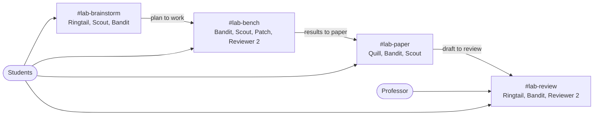

# RaccoonLabs

**A research lab in Slack for student research groups.** Students do the thinking, AI lab members do the legwork, and a human professor signs off. Each student brings their own agent and subscription, and [Switch](https://github.com/sandbox-quantum/switch) pools them into one lab.

Built for the WeMakeDevs *Flip the Switch* hackathon, for Track 1 and Track 2.

Student groups spend their time on LaTeX, figures, citations, reading lists and tracking who is doing what, and nobody checks the work until the professor does. RaccoonLabs gives the group a postdoc who pushes back on ideas, a lab manager, a librarian, an engineer who won't run anything without a student's approval, a scribe who builds the PDF, and a peer reviewer who rejects any claim with fewer than 3 seeds.

**What comes out:** a compiled paper posted in Slack, where every result traces to a logged batch that a person approved.

## How it works



1. **Brainstorm.** A student brings a question to `#lab-brainstorm`. Ringtail asks what would change their mind, Scout fills `Library` through `lab-search`, and Ringtail writes `Plan`. Students approve it, then the professor approves it in `#lab-review`.
2. **Bench.** Bandit posts `Tasks` and assigns the work. Patch posts each batch's seeds, time and exact command, then stops until a student replies. `labrun` records the approval and the results.
3. **Review of results.** Reviewer 2 checks the manifest, the logs and who really approved. Accepted numbers go in `Notebook`.
4. **Paper.** Students choose which sections are theirs. Quill drafts the rest, with a diagram and plots from the run files, and posts the PDF.
5. **Integrity check.** `lab-integrity` checks that every citation came through `lab-search`, every results number traces to a logged batch or gets flagged, overlap with collected sources is flagged, and an AI use disclosure is present. Only then does the professor see the draft.

### Who each agent is

Everyone in a room can address its agents. They run on one person's machine, as that person's user.

| Agent | Job | Runtime and model | Rooms | What it can reach |
|---|---|---|---|---|
| Ringtail | Postdoc: pushes back, writes the plan, final read | Claude Code, Sonnet | brainstorm, review | Room documents, `lab-envelope` |
| Bandit | Lab Manager: tasks, assignments, notebook | Claude Code, Haiku | all | Room documents |
| Scout | Librarian: finds and tracks sources | OpenCode, free model | brainstorm, bench, paper | `lab-search` only for literature |
| Patch | Engineer: runs approved experiments | Claude Code, Sonnet | bench | `uv`, `labrun` |
| Quill | Scribe: writes assigned sections, builds the PDF | Claude Code, Sonnet | paper | `lab-paper`, `tectonic`, `send_attachment` |
| Reviewer 2 | Peer reviewer: checks evidence and integrity | Codex | bench, review | `labrun`, `lab-integrity`, read-only checks; no network from its shell |

[`docs/agent-access.md`](docs/agent-access.md) records what we measured each agent can and can't reach, including the gaps.

### Why Switch is central

Without Switch, this is one person with subagents. With it:

- **Pooled subscriptions.** Claude, Codex and OpenCode agents work in the same rooms, and each could belong to a different student.
- **People in the loop where they already are.** Approvals are ordinary Slack replies, so they work from a phone.
- **Per-room access.** A professor only needs `#lab-review`. Agents only join the rooms their job needs.
- **Shared memory that people can read.** `Plan`, `Tasks`, `Library` and `Notebook` are Switch room documents.
- **One template.** [`switch/lab.template.yaml`](switch/lab.template.yaml) creates the agents, rooms and links.

## Try it

### Tools only, in seconds, with no accounts

Needs [`just`](https://github.com/casey/just), [`uv`](https://docs.astral.sh/uv/) and [`tectonic`](https://tectonic-typesetting.github.io/). The first tectonic build downloads its LaTeX bundle, which took us about 19 minutes.

```sh
just demo-cpu
```

This runs seeded batches through `labrun`, builds a PDF with a real plot, runs the integrity check, seals and opens an envelope, and checks a scorecard. No agents or Slack are involved, so it shows the tools and not the workflow. Output goes in `build/demo-cpu/`.

### The full lab in Slack

Needs [Switch Console](https://github.com/sandbox-quantum/switch) with a local server and Slack connected, and at least one of `claude`, `codex` and `opencode` signed in.

```sh
just up        # checks this machine, installs the tools, builds the template, prints the Console steps
```

Then in Console, select **Templates → Import template**, choose `switch/lab.template.yaml`, and select **Use → Create all**. Back in the terminal:

```sh
just harden    # closes web tools Switch's own setting leaves open on Scout and Reviewer 2
```

Then address `@ringtail` with a question in `#lab-brainstorm`.

On Linux under Hyprland, launch Console with `--password-store=gnome-libsecret`. Agents use OpenCode 1.x, because Switch 0.31 can't start OpenCode 2.x sessions.

## The envelope: a demo device, not a product feature

To show the lab isn't performing for the camera, our demo gives it an open question whose answer already sits in a published paper that the agents haven't been shown. The paper is encrypted in `envelope/sealed.enc`, and `lab-search` withholds it using a list of hashes. When the work is done, a student posts `@ringtail unseal <passphrase>`, and Ringtail fills in a claim-by-claim scorecard with matches, partial matches and misses, each tied to a batch ID.

What this does and doesn't prove:

- The students are role-played on one laptop, and we knew the paper. The agents didn't get it from us.
- Claude Code and Codex agents have no built-in web tools. Scout reports none since `just harden`.
- A Claude agent's shell can still reach the network, and any agent can read this user's files. So we don't claim they *couldn't* have looked. `just audit` lists every network command and sealed-path access recorded in the agents' session logs.

## Tools

| Command | What it does |
|---|---|
| `labrun` | Runs a command across seeds and keeps a manifest, logs, the approver and a sha256 |
| `lab-search` | Searches arXiv, Crossref and Semantic Scholar, applies the blocklist, logs every query |
| `lab-paper` | Starts and compiles the LaTeX paper, and fails on undefined citations |
| `lab-integrity` | Checks citations, numbers, overlap and the disclosure |
| `lab-envelope` | Seals and opens the envelope, and checks a scorecard |

`just test` runs the test suite. `just --list` shows every recipe.

## Limits

- `labrun` records what it's told. It can't tell a forged approval from a real one, so Reviewer 2 checks it against the room. Evidence files guard against accidents, not against someone deleting them: the posted sha256 is the anchor.
- Everything has run on one 7.5 GB laptop. Six agent sessions and a browser took available memory down to about 1.2 GB.
- The integrity check isn't plagiarism detection. It compares against the abstracts `lab-search` returned.
